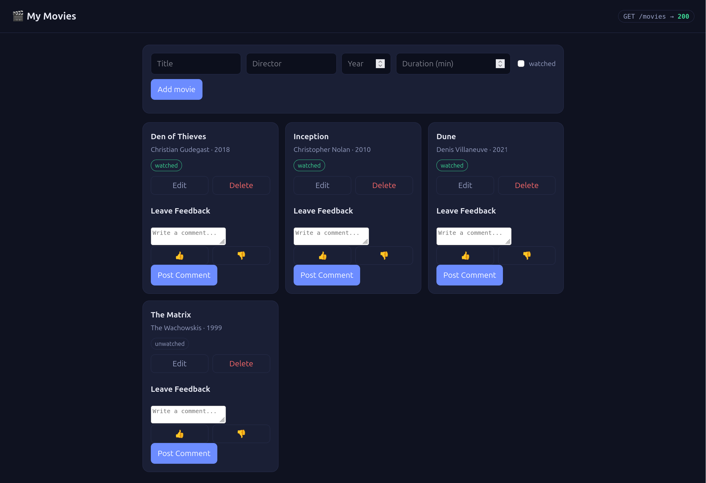
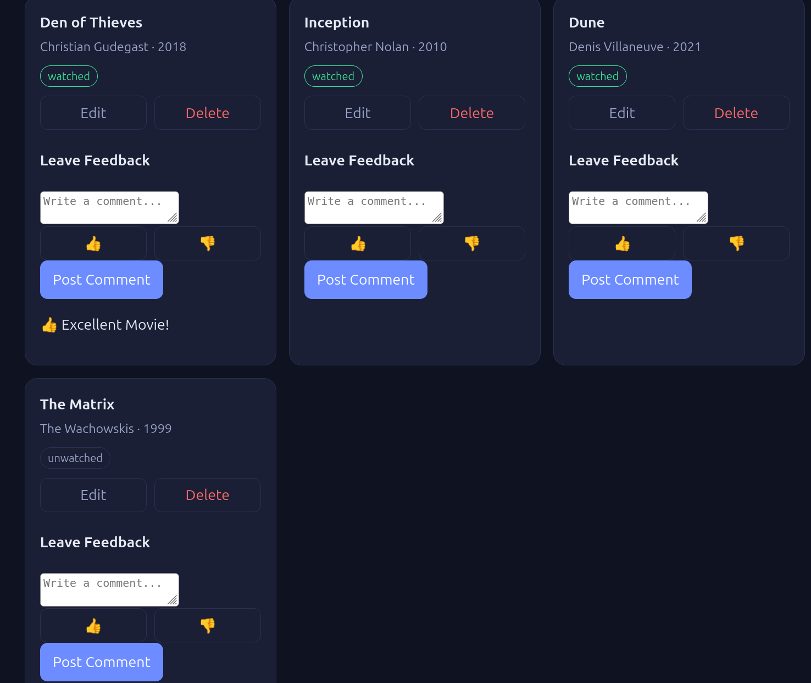
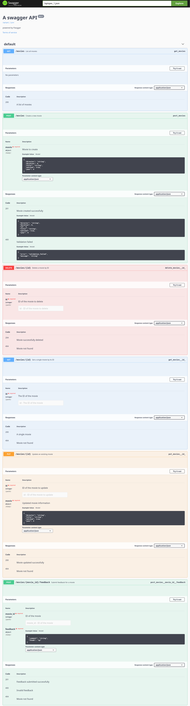

# 🎬 Movies API

A full-stack movie management application built with Python, Flask, and JavaScript. This project provides a REST API for managing a personal movie collection, including creating, retrieving, updating, and deleting movies, filtering by director, and submitting movie feedback.

The application also features an interactive frontend that communicates with the Flask backend using JavaScript Fetch API.

## 📸 Screenshots

### Movies Dashboard


### Movie Feedback


### Swagger API Documentation


## 🚀 Features

### Movie Management
- Create new movie entries.
- Retrieve all movies.
- Retrieve individual movies by ID.
- Update existing movie information.
- Delete movies from the collection.
- Filter movies by director.
- Track movie duration and watched status.

### Movie Feedback
- Submit thumbs-up or thumbs-down reactions.
- Attach optional comments to feedback.
- Associate feedback with individual movies.
- Display submitted feedback in the frontend.

**Note:** The backend currently requires a thumbs-up or thumbs-down reaction when submitting feedback. Standalone comment submission is a planned improvement.

### Validation and Error Handling
- Validate required fields when creating movies.
- Validate incoming data types.
- Return appropriate HTTP status codes.
- Provide structured JSON error responses.
- Handle requests for movies that do not exist.

### API Documentation
- Integrated Swagger documentation using Flasgger.
- Interactive API documentation available through Swagger UI.
- Explore and test API endpoints directly through the browser.

## 🛠️ Technologies Used

| Technology | Purpose |
|---|---|
| Python | Backend programming |
| Flask | Web framework and API development |
| Flasgger | Swagger API documentation |
| JavaScript | Frontend functionality |
| HTML5 | Frontend structure |
| CSS3 | Frontend styling |
| REST API | Client-server communication |
| JSON | Data exchange |
| Git & GitHub | Version control |

## 📂 Project Structure

```text
movies-api-flask/
│
├── app.py
├── index.html
├── requirements.txt
├── README.md
│
└── screenshots/
    ├── dash.png
    ├── feedback.png
    └── swagger.png
```

The `.venv` directory is your local Python virtual environment and should not be committed to GitHub.

## ⚙️ Installation and Setup

### 1. Clone the repository

```bash
git clone https://github.com/heintzmason2-sys/movies-api-flask.git
```

### 2. Navigate into the project

```bash
cd movies-api-flask
```

### 3. Create a virtual environment

```bash
python3 -m venv .venv
```

### 4. Activate the virtual environment

```bash
source .venv/bin/activate
```

### 5. Install dependencies

```bash
pip install -r requirements.txt
```

### 6. Start the Flask application

```bash
python3 app.py
```

The application runs locally at:

```text
http://127.0.0.1:5000
```

### Swagger Documentation

Interactive API documentation is available at:

```text
http://127.0.0.1:5000/apidocs/
```

## 📡 API Endpoints

The following endpoints are implemented:

| HTTP Method | Endpoint | Description |
|---|---|---|
| GET | `/movies` | Retrieve all movies |
| GET | `/movies?director=Christopher Nolan` | Filter movies by director |
| GET | `/movies/<id>` | Retrieve a movie by ID |
| POST | `/movies` | Create a new movie |
| PUT | `/movies/<id>` | Update an existing movie |
| DELETE | `/movies/<id>` | Delete a movie |
| POST | `/movies/<movie_id>/feedback` | Submit movie feedback |

## 📝 API Request Examples

### Create a Movie

**POST** `/movies`

Request body:

```json
{
  "title": "Interstellar",
  "director": "Christopher Nolan",
  "year": 2014,
  "watched": true,
  "duration": 169
}
```

Successful response: `201 Created`

### Retrieve All Movies

**GET** `/movies`

Returns a JSON array containing the movie collection.

### Retrieve a Single Movie

**GET** `/movies/1`

Returns the movie matching the requested ID.

### Update a Movie

**PUT** `/movies/1`

Request body:

```json
{
  "title": "Inception",
  "director": "Christopher Nolan",
  "year": 2010,
  "watched": true
}
```

Successful response: `200 OK`

### Delete a Movie

**DELETE** `/movies/1`

Successful response: `204 No Content`

### Submit Movie Feedback

**POST** `/movies/1/feedback`

Request body:

```json
{
  "thumb": "up",
  "comment": "Great movie!"
}
```

The `thumb` field accepts either `"up"` or `"down"`. The comment field is optional.

Successful response: `201 Created`

## 🔒 Error Handling

The API uses HTTP status codes to communicate request results.

| Status Code | Meaning |
|---|---|
| 200 | Request successful |
| 201 | Resource successfully created |
| 204 | Resource successfully deleted |
| 400 | Invalid request or validation failure |
| 404 | Requested movie not found |

Errors are returned as JSON responses containing an error identifier and descriptive message.

Example:

```json
{
  "error": "not_found",
  "message": "Movie with id 99 was not found."
}
```

## 💾 Data Storage

The application currently stores movie records and feedback in memory using Python data structures.

**Important:** Data is not persisted between server restarts. Restarting the Flask application resets
